# Usus

**Castellano** · [English](#english)

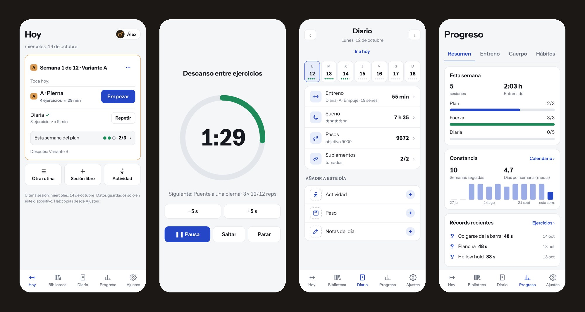

**Usus** (latín: *práctica, hábito*) es una app para registrar tus entrenamientos y tus hábitos desde el móvil. Pensada para calistenia y entrenamiento en casa, sirve para cualquier rutina de series y repeticiones.

**[Abrir Usus →](https://oluengo.github.io/usus/)**

Gratis, sin cuentas y sin anuncios. Todo se guarda **solo en tu móvil**: nada se envía a ningún servidor ([privacidad](PRIVACY.md)).

*Hecha con IA · probada por humanos.*

## Instalar

| | Cómo | Actualizaciones |
|---|---|---|
| **Web (PWA)** · Android, iPhone, ordenador | Abre [oluengo.github.io/usus](https://oluengo.github.io/usus/). Android (Chrome): menú ⋮ → «Instalar aplicación». iPhone (Safari): Compartir → «Añadir a pantalla de inicio». | Solas, al abrirla |
| **App Android (APK)** | Descarga `usus-X.Y.Z.apk` de la [última versión](https://github.com/oluengo/usus/releases/latest) y ábrelo. Android pedirá permiso para «instalar apps de este origen». | Instalando la nueva encima |
| **APK con Obtainium** | En [Obtainium](https://github.com/ImranR98/Obtainium), «Añadir app» → `https://github.com/oluengo/usus`. | Obtainium avisa e instala |

**¿Cuál?** En Android, mejor el **APK**: no depende del navegador, la pantalla se mantiene encendida al entrenar y el botón Atrás funciona como en cualquier app. La **PWA** es para iPhone, ordenador o para probarla sin instalar nada.

- PWA y APK son la misma app, pero **cada una guarda sus datos aparte**. Para pasar de una a otra: Ajustes → Datos → exportar copia en una, importarla en la otra.
- El APK solo pide un permiso, **vibración** (avisos del descanso). Sin Internet: no se conecta a nada. Importar y exportar usan el selector de archivos y el menú de compartir de Android.
- El APK va firmado; huella SHA-256 del certificado: `28:B6:FF:4A:8F:61:F6:88:D4:B4:9D:C7:E8:B7:2D:95:D5:D9:44:45:D2:A2:30:07:1A:FA:72:B1:B2:D0:3E:C8`. Más detalles en [ANDROID.md](ANDROID.md).

## Cómo funciona

- **Rutinas.** Creas tus rutinas con sus ejercicios, series y repeticiones o tiempo. Puedes marcar ejercicios «por lado», poner lastre y un descanso propio a cada uno. Si quieres, las ordenas por secciones (calentamiento, principal, core, vuelta a la calma) y agrupas ejercicios en superseries o circuitos. En el ordenador o la tablet hay un **modo edición para pantalla grande**: cada ejercicio en una fila y el catálogo al lado. Cada rutina se puede imprimir o guardar en PDF: una hoja por ejercicio para seguir su progresión, o la rutina entera con varias sesiones.
- **Ejercicios** *(opcional).* Un catálogo de ejercicios de calistenia, cada uno con su ficha: para qué sirve, cómo se hace, errores típicos, material necesario y progresión, del más fácil al más difícil. Se elige ejercicio al crear la rutina y se ve la ficha en cualquier momento, también entrenando.
- **Progresión.** Al terminar una sesión, Usus te propone pasar al siguiente ejercicio cuando dominas el actual, o volver al anterior si te está costando demasiado. Siempre es una propuesta: decides tú.
- **Hoy.** Te dice qué toca cada día. Con un plan de progresión, Usus rota las variantes de tus rutinas por semanas (A, B, C…), añade semanas de descarga y te avisa de lo pendiente. Si quieres, la subida de cada vuelta de variante se aplica sola, con aviso y opción de deshacer.
- **Entrenar.** Un ejercicio por pantalla. Las series por tiempo y los descansos tienen cuenta atrás a pantalla completa con reglas sencillas (preparación, aviso final, cambio de lado y descansos), tres sonidos suaves (tic, inicio, fin), vibración o nada, y se pueden encadenar solas. La pantalla se mantiene encendida durante la sesión. Puedes cambiar un ejercicio sobre la marcha, anotar cada uno y valorar el esfuerzo de la sesión (y, si quieres, las repeticiones en reserva de cada serie).
- **Diario.** Sueño, suplementos, pasos, actividad (caminar, correr, bici…), notas y peso semanal.
- **Estadísticas.** Constancia, récords, progreso por ejercicio, equilibrio entre lados y hábitos, en bloques que puedes ordenar u ocultar. Los días con notas llevan un punto: tócalo y ves por qué (no entrenaste, molestias, un cambio de ejercicio…).
- **Análisis con IA** *(opcional, externa).* Usus prepara un texto con tus datos y las instrucciones para que la IA que prefieras haga un informe con gráficos, listo para imprimir. Usus no envía nada: lo copias o compartes tú.
- **Perfiles.** Varias personas en el mismo móvil, cada una con sus datos, ajustes y copia de seguridad.
- **Ciclo** *(opcional, en perfiles de mujer).* Registro de la regla con una estimación aproximada de la próxima. No es un anticonceptivo ni un diagnóstico.
- **Compartir.** Un entreno como imagen o texto, o tus rutinas y tu plan mediante un enlace que lleva los datos dentro, sin pasar por ningún servidor.

<table>
<tr>
<td align="center" width="25%">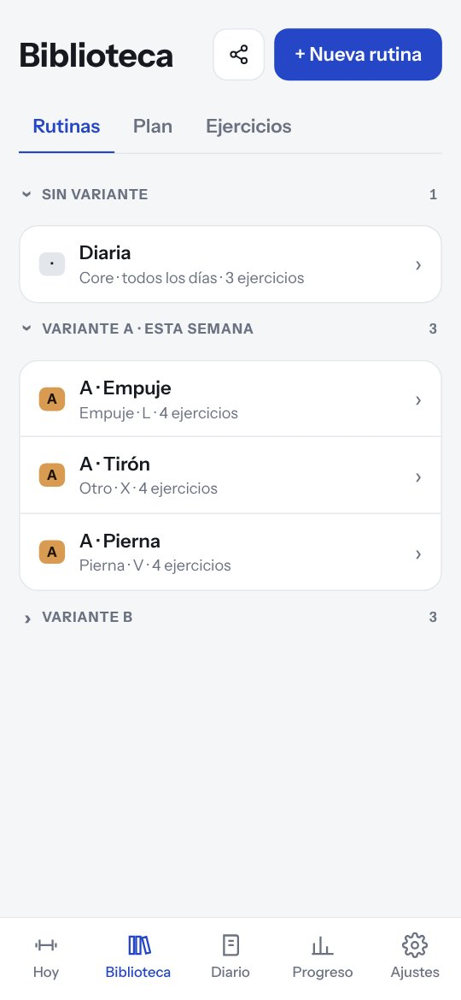 Rutinas</td>
<td align="center" width="25%">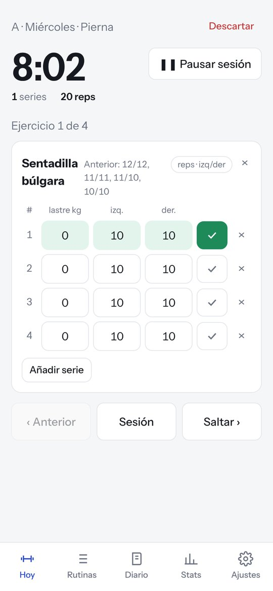 Sesión</td>
<td align="center" width="25%">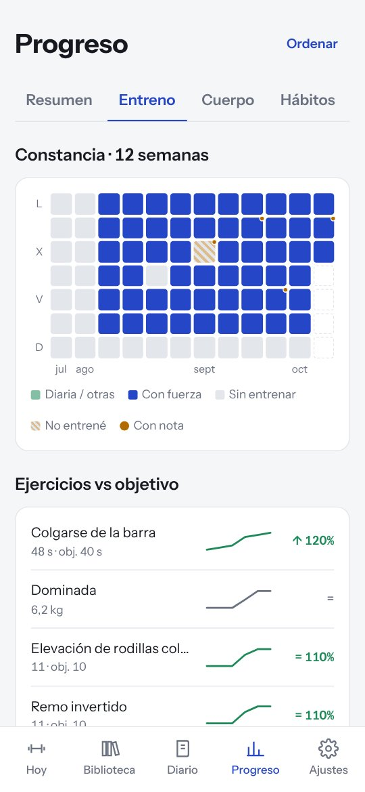 Constancia y progreso</td>
<td align="center" width="25%">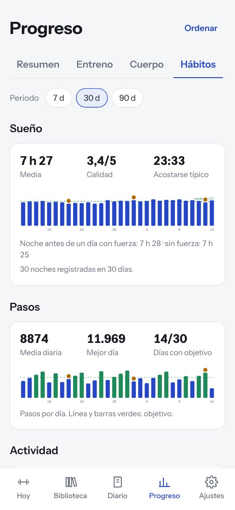 Hábitos</td>
</tr>
<tr>
<td align="center">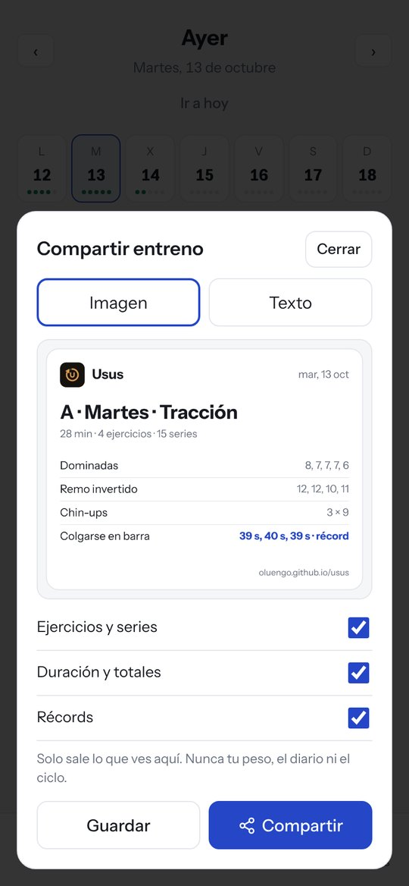 Compartir un entreno</td>
<td align="center">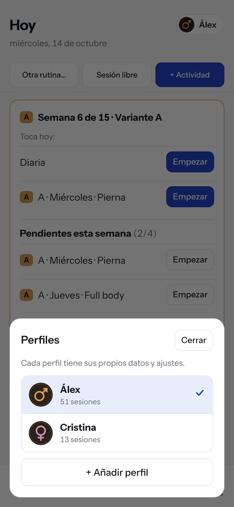 Perfiles</td>
<td align="center">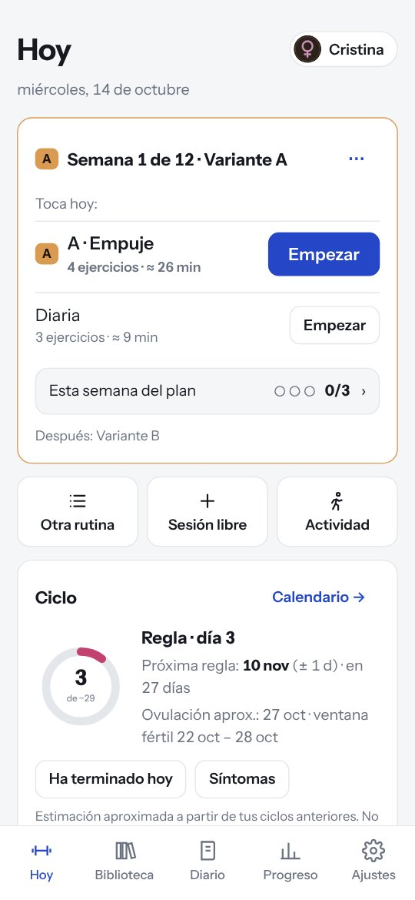 Ciclo (opcional)</td>
<td align="center">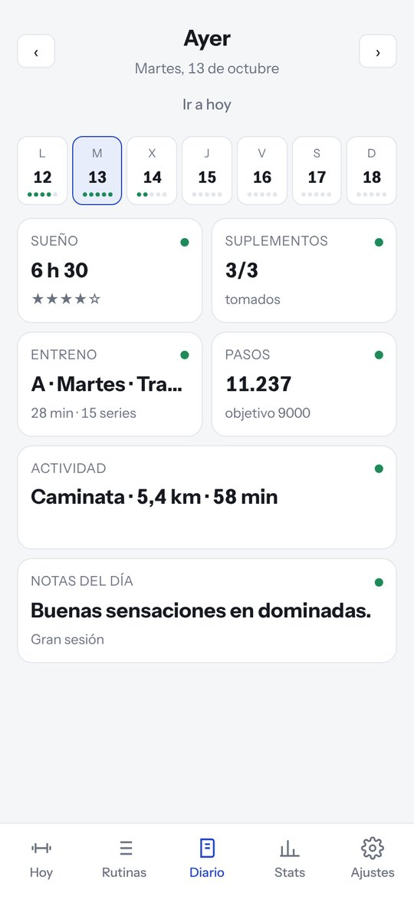 Diario</td>
</tr>
<tr>
<td align="center">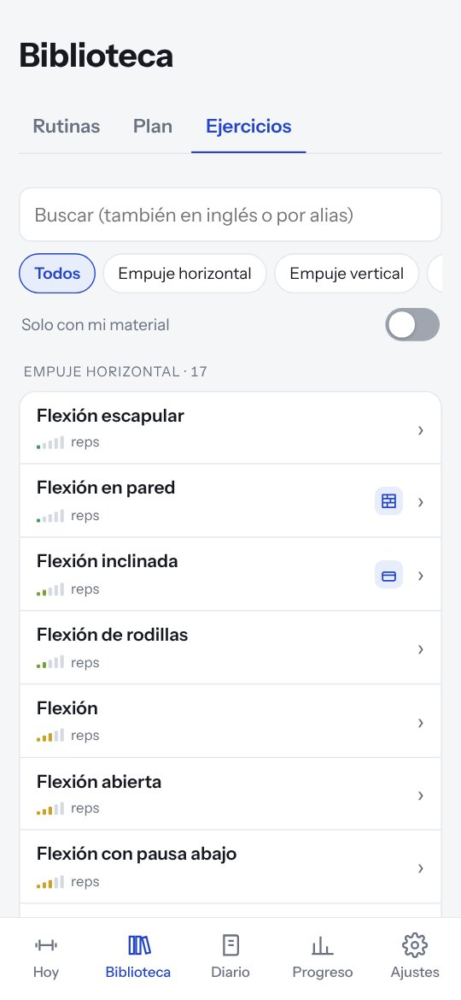 Ejercicios (opcional)</td>
<td align="center">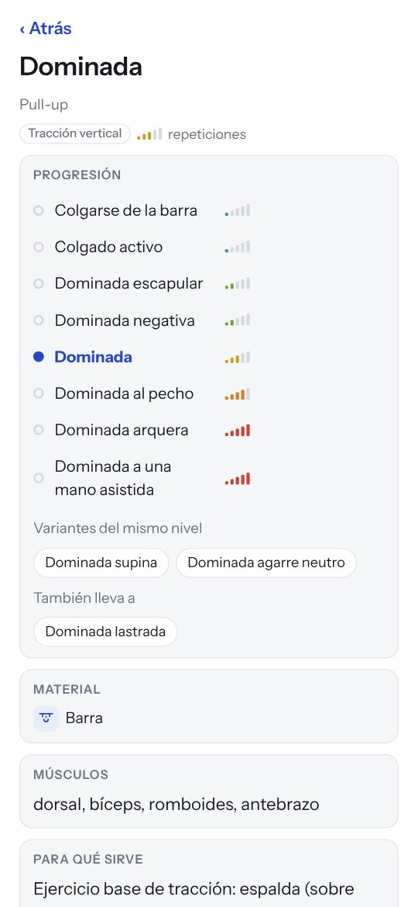 Ficha y progresión</td>
<td align="center">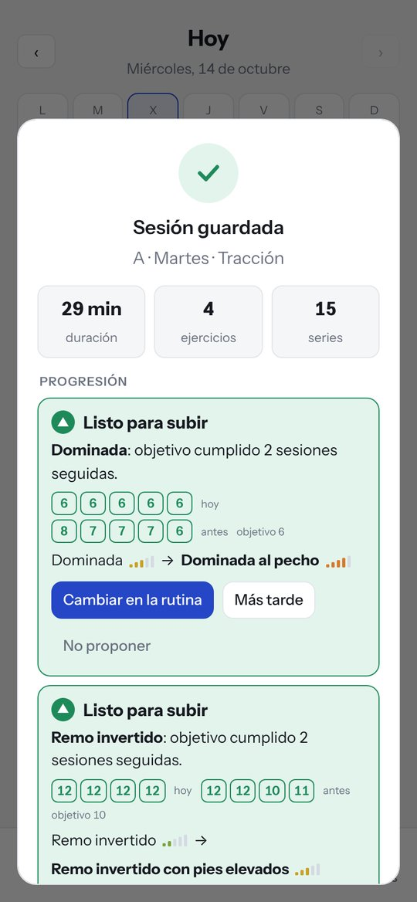 Propuesta al terminar</td>
<td align="center">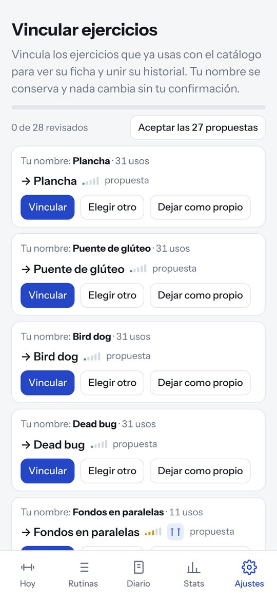 Vincular tus ejercicios</td>
</tr>
</table>

### Tanta información como quieras

El catálogo de ejercicios es **opcional y se decide en cada perfil**. Si empiezas, actívalo: tendrás la explicación de cada ejercicio, el material que necesita y por dónde seguir. Si ya sabes lo que haces, prescinde de él: Usus funciona igual con tus propios ejercicios, sin información de más. Por ahora, las fichas están en castellano. Se puede cambiar en cualquier momento, y tus ejercicios se pueden vincular al catálogo para unir su historial.

### Temas

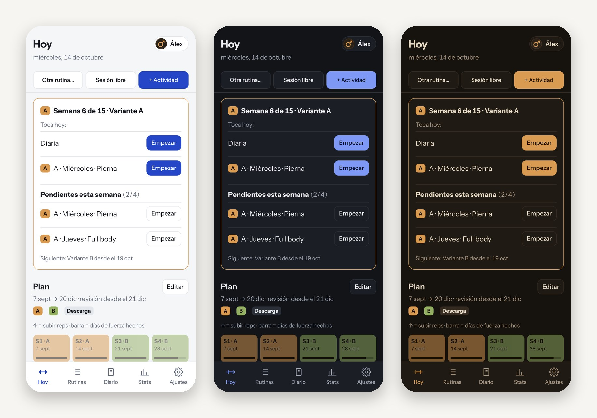

**Claro**, **Oscuro** y **Protector** (oscuro cálido, sin luz azul, para entrenar a primera hora). Por defecto, **Automático**: sigue el modo claro u oscuro del móvil.

### Más

- Funciona sin conexión, como PWA o como app de Android ([instalar](#instalar)).
- Castellano, català e English.
- Copias de seguridad en un archivo, para pasar tus datos a otro móvil o guardarlos, y exportación en CSV para analizarlos a tu manera.
- [Informar de un problema o proponer una mejora](https://github.com/oluengo/usus/issues).

Capturas con datos de ejemplo. Usus es una herramienta de registro, no un consejo médico ni un plan de entrenamiento. Software libre, [licencia MIT](LICENSE).

---

## English

**Usus** (Latin: *practice, habit*) is a phone app to log your workouts and habits. Built with calisthenics and home training in mind, it works for any routine of sets and reps.

**[Open Usus →](https://oluengo.github.io/usus/)**

Free, no accounts, no ads. Everything is stored **only on your phone**: nothing is ever sent to a server ([privacy](PRIVACY.md#english)).

*Built with AI · tested by humans.*

### Install

| | How | Updates |
|---|---|---|
| **Web (PWA)** · Android, iPhone, desktop | Open [oluengo.github.io/usus](https://oluengo.github.io/usus/). Android (Chrome): ⋮ menu → “Install app”. iPhone (Safari): Share → “Add to Home Screen”. | Automatic, when you open it |
| **Android app (APK)** | Download `usus-X.Y.Z.apk` from the [latest release](https://github.com/oluengo/usus/releases/latest) and open it. Android will ask to allow installing apps from that source. | Install the new one on top |
| **APK with Obtainium** | In [Obtainium](https://github.com/ImranR98/Obtainium), “Add app” → `https://github.com/oluengo/usus`. | Obtainium notifies and installs |

**Which one?** On Android, the **APK** is better: it doesn't depend on the browser, keeps the screen on while you train and the Back button works like in any app. The **PWA** is for iPhone, desktop, or trying it without installing anything.

- PWA and APK are the same app, but **each keeps its own data**. To move between them: Settings → Data → export a backup in one, import it in the other.
- The APK asks for one permission only, **vibration** (rest alerts). No Internet: it connects to nothing. Import and export use Android's file picker and share menu.
- The APK is signed; SHA-256 certificate fingerprint: `28:B6:FF:4A:8F:61:F6:88:D4:B4:9D:C7:E8:B7:2D:95:D5:D9:44:45:D2:A2:30:07:1A:FA:72:B1:B2:D0:3E:C8`. More in [ANDROID.md](ANDROID.md#english).

### How it works

- **Routines.** Build routines with exercises, sets and reps or time. Mark exercises as “per side”, add weight and set a rest time for each one. If you like, split them into sections (warm-up, main, core, cool-down) and group exercises into supersets or circuits. On a computer or tablet there's an **edit mode for large screens**: one row per exercise and the catalogue alongside. Any routine can be printed or saved as PDF: one sheet per exercise to track its progress, or the whole routine across several sessions.
- **Exercises** *(optional).* A catalogue of calisthenics exercises, each with its own card: what it's for, how to do it, common mistakes, equipment needed and progression, from easiest to hardest. Pick exercises when building a routine and check the card at any time, even mid-workout.
- **Progression.** After a session, Usus suggests moving on to the next exercise once you've mastered the current one, or going back to the previous one if it's too hard for now. It's always a suggestion: you decide.
- **Today.** Shows what's on each day. With a progression plan, Usus rotates your routine variants week by week (A, B, C…), adds deload weeks and keeps track of what's pending. If you like, the increase each time a variant comes back is applied automatically, with a notice and an undo option.
- **Train.** One exercise per screen. Timed sets and rests get a full-screen countdown with simple rules (get-ready, final warning, side switch and rests), three soft sounds (tick, start, end), vibration or nothing, and can chain automatically. The screen stays on during the session. Swap an exercise on the fly, add a note to each one and rate the session's effort (and, if you like, the reps in reserve of each set).
- **Diary.** Sleep, supplements, steps, activity (walking, running, cycling…), notes and weekly weight.
- **Stats.** Consistency, PRs, progress per exercise, left/right balance and habits, in blocks you can reorder or hide. Days with notes get a dot: tap it to see why (you skipped training, aches, a swapped exercise…).
- **AI analysis** *(optional, external).* Usus prepares a text with your data and instructions for the AI of your choice to write a report with charts, ready to print. Usus sends nothing: you copy or share it yourself.
- **Profiles.** Several people on the same phone, each with their own data, settings and backup.
- **Cycle** *(optional, on women's profiles).* Period log with an approximate estimate of the next one. Not a contraceptive method or a diagnosis.
- **Share.** A workout as an image or text, or your routines and plan through a link that carries the data itself, with no server involved.

<table>
<tr>
<td align="center" width="25%"> Routines</td>
<td align="center" width="25%"> Session</td>
<td align="center" width="25%"> Consistency and progress</td>
<td align="center" width="25%"> Habits</td>
</tr>
<tr>
<td align="center"> Share a workout</td>
<td align="center"> Profiles</td>
<td align="center"> Cycle (optional)</td>
<td align="center"> Diary</td>
</tr>
<tr>
<td align="center"> Exercises (optional)</td>
<td align="center"> Card and progression</td>
<td align="center"> Suggestion after a session</td>
<td align="center"> Link your exercises</td>
</tr>
</table>

Screenshots in Spanish.

### As much information as you want

The exercise catalogue is **optional and chosen per profile**. If you're starting out, turn it on: you'll get an explanation of each exercise, the equipment it needs and where to go next. If you already know what you're doing, skip it: Usus works just the same with your own exercises, without the extra information. For now, the cards are in Spanish only. You can change it at any time, and link your exercises to the catalogue to merge their history.

### Themes

**Light**, **Dark** and **Protector** (warm dark, no blue light, for early-morning training). **Automatic** by default: follows your phone's light or dark mode.

### More

- Works offline, as a PWA or as an Android app ([install](#install)).
- Español, català and English.
- File backups, to move your data to another phone or keep it safe, and CSV export to analyse it your way.
- [Report a problem or suggest an improvement](https://github.com/oluengo/usus/issues).

Screenshots use sample data. Usus is a logging tool, not medical advice or a training plan. Free software, [MIT license](LICENSE).
