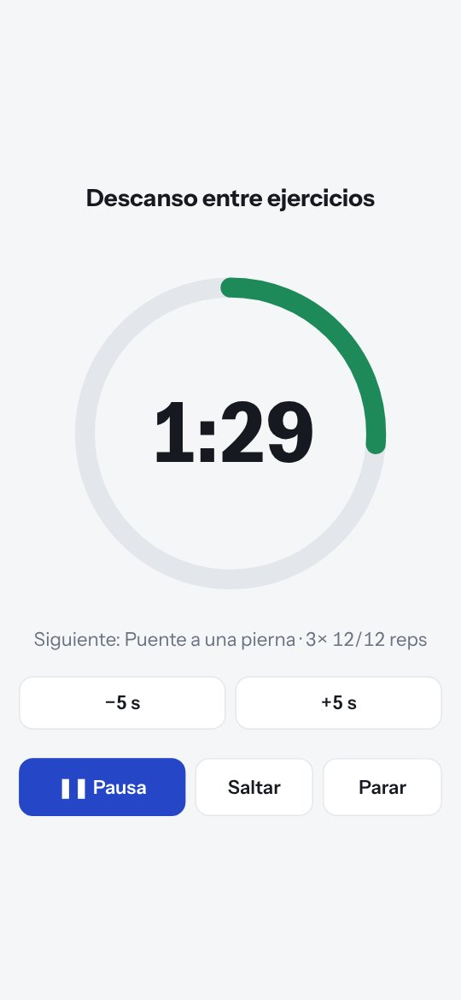
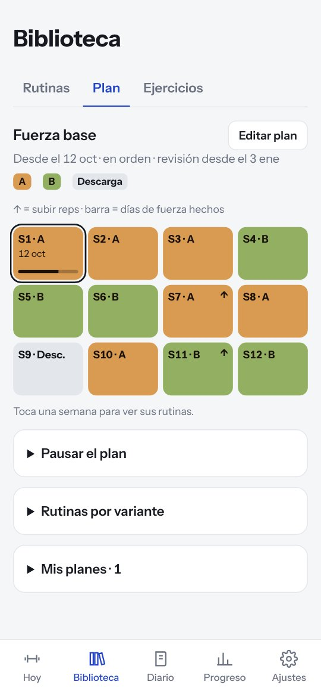
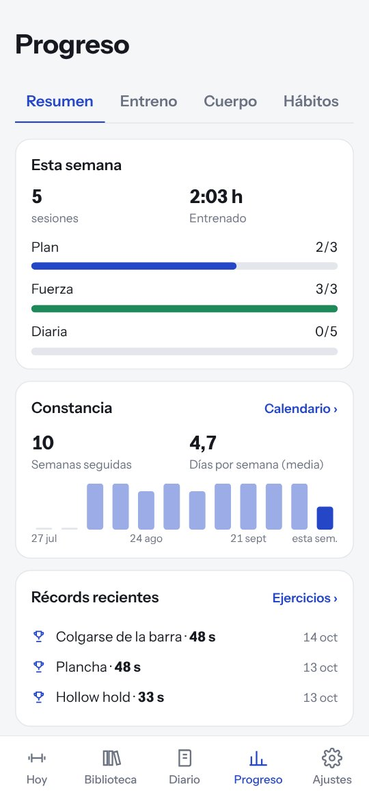

# Usus

**Castellano** · [English](#english)

**Usus** (latín: *práctica, hábito*) registra tus entrenamientos y tus hábitos desde el móvil. Pensada para calistenia y entrenamiento en casa; vale para cualquier rutina de series y repeticiones.

Gratis, sin cuentas ni anuncios y sin conexión. Todo se guarda **solo en tu móvil** ([privacidad](PRIVACY.md)). En castellano, català e inglés.

**[Abrir Usus →](https://oluengo.github.io/usus/)** · **[Descargar para Android](https://github.com/oluengo/usus/releases/latest)**

## Instalar

- **Android:** el APK de la [última versión](https://github.com/oluengo/usus/releases/latest), o añade `https://github.com/oluengo/usus` en [Obtainium](https://github.com/ImranR98/Obtainium) para recibir las actualizaciones.
- **iPhone u ordenador:** abre [la web](https://oluengo.github.io/usus/) e instálala desde el navegador (Safari: Compartir → «Añadir a pantalla de inicio»).

Web y APK guardan sus datos por separado: pásalos con una copia (Ajustes → Datos). Firma, permisos y versión beta: [ANDROID.md](ANDROID.md).

## Qué hace

- **Rutinas** con series, repeticiones o tiempo, por lado, lastre, secciones, superseries y circuitos. Se imprimen o se guardan en PDF.
- **Catálogo de ejercicios** *(opcional)*: ficha de cada uno, material y progresión.
- **Plan guiado**, o **con IA** *(opcional, externa)*: rutinas a tu nivel y un plan que rota variantes en orden, con descargas y pausas.
- **Progresión**: al terminar, Usus propone pasar al siguiente ejercicio o volver al anterior. Decides tú.
- **Entrenar**: un ejercicio por pantalla y cuenta atrás a pantalla completa con sonido o vibración.
- **Diario** de sueño, pasos, peso, actividad y notas, y **Progreso** con constancia, récords y hábitos.
- **Análisis con IA** *(opcional, externa)*: Usus prepara tus datos para que la IA que elijas haga un informe con gráficos. Usus no envía nada.
- **Perfiles** para varias personas, registro opcional del **ciclo**, temas claro, oscuro y protector.
- **Compartir** entrenos y rutinas sin servidores; copias de seguridad y CSV.

<table><tr>
<td width="25%"></td>
<td width="25%"></td>
<td width="25%"></td>
<td width="25%"></td>
</tr></table>

[Novedades](CHANGELOG.md) · [Informar de un problema](https://github.com/oluengo/usus/issues) · [Traducciones](i18n/README.md) · [Código](src/README.md)

Herramienta de registro, no consejo médico. Software libre, [licencia MIT](LICENSE). Hecha con IA · probada por humanos.

---

## English

**Usus** (Latin: *practice, habit*) logs your workouts and habits on your phone. Built for calisthenics and home training; it works for any routine of sets and reps.

Free, no accounts, no ads and works offline. Everything is stored **only on your phone** ([privacy](PRIVACY.md#english)). In Spanish, Catalan and English.

**[Open Usus →](https://oluengo.github.io/usus/)** · **[Download for Android](https://github.com/oluengo/usus/releases/latest)**

### Install

- **Android:** the APK from the [latest release](https://github.com/oluengo/usus/releases/latest), or add `https://github.com/oluengo/usus` to [Obtainium](https://github.com/ImranR98/Obtainium) to get updates.
- **iPhone or computer:** open [the web app](https://oluengo.github.io/usus/) and install it from the browser (Safari: Share → “Add to Home Screen”).

Web and APK keep separate data: move it with a backup (Settings → Data). Signing, permissions and beta: [ANDROID.md](ANDROID.md#english).

### What it does

- **Routines** with sets, reps or time, per side, added weight, sections, supersets and circuits. Print them or save them as PDF.
- **Exercise catalogue** *(optional)*: a card for each one, equipment and progression.
- **Guided plan**, or **with AI** *(optional, external)*: routines at your level and a plan that rotates variants in order, with deloads and pauses.
- **Progression**: after a session, Usus suggests moving to the next exercise or back to the previous one. You decide.
- **Train**: one exercise per screen and a full-screen countdown with sound or vibration.
- **Diary** for sleep, steps, weight, activity and notes, and **Progress** with consistency, PRs and habits.
- **AI analysis** *(optional, external)*: Usus prepares your data for the AI of your choice to write a report with charts. Usus sends nothing.
- **Profiles** for several people, optional **cycle** tracking, light, dark and protector themes.
- **Share** workouts and routines with no servers; backups and CSV.

[Changelog](CHANGELOG.md#english) · [Report a problem](https://github.com/oluengo/usus/issues) · [Translations](i18n/README.md) · [Code](src/README.md)

A logging tool, not medical advice. Free software, [MIT license](LICENSE). Built with AI · tested by humans. Screenshots in Spanish.
